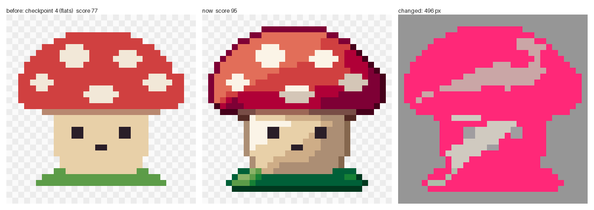
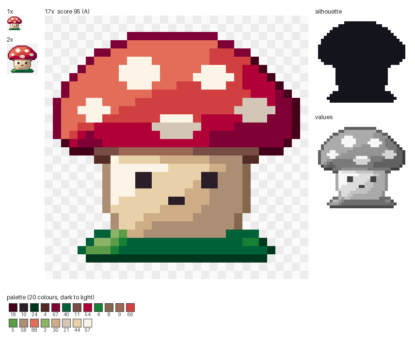
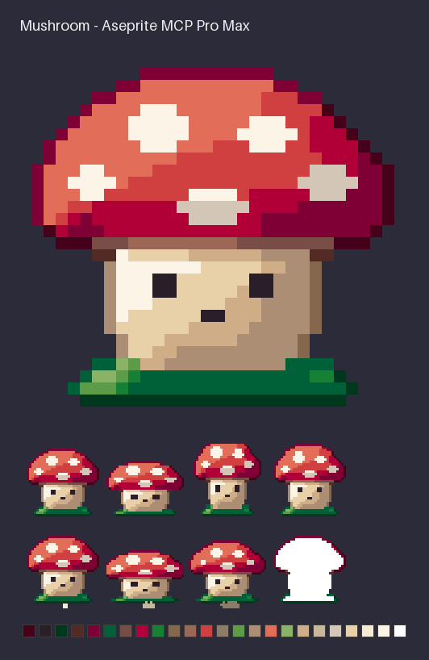

# Aseprite MCP Pro Max

An MCP server that gives AI assistants full control over [Aseprite](https://www.aseprite.org/) — and, on top of that, **the eye and the polish of a pixel-art lead**.

**156 tools**: a complete drawing, animation and export toolkit, plus a quality layer that makes the art that comes out *better*, not just possible.

| | What you get |
|---|---|
| Sees its work | `view_sprite` (zoomed frames with rulers) and `view_quality`: 1x/2x, silhouette, values, palette, problems outlined on the sprite |
| Knows what's wrong | `critique_sprite`: score 0–100, ~20 craft checks with coordinates and the fixing tool; `lint_sprite` for stray/detached pixels |
| Fixes it | `polish_sprite`, `cleanup_lines` (pixel-perfect), `remove_stray_pixels`, `merge_similar_colors` |
| Shading | `auto_shade`: one-light shading from flats, hue-shifted ramps, decal-aware, contact shadows, rim light |
| Outlines | `outline_pro`: fixed, coloured, **selective (sel-out)**, inside/outside |
| Colour | perceptual **OKLab/OKLCH** ramps & palettes, `analyze_palette`, `quantize_pro` with Bayer/Floyd/Atkinson, retro presets |
| Iteration | `save_checkpoint` / `compare_versions` / `restore_checkpoint` with scores |
| Animation | frames, cels, tags, eased tweens, plus `squash_stretch`, `add_smear`, `hit_flash`, `generate_particles`, `secondary_motion`, `critique_animation` |
| Conversion | `image_to_pixel_art` (detects the true grid of upscaled/AI "pixel art"), `rotsprite_rotate` |
| Shipping | PNG/GIF/sprite sheets, `export_showcase`, Scale2x/3x `export_upscaled`, padded & extruded `export_spritesheet_pro` with JSON, `generate_normal_map` |

### The Pro Max loop

The server tells the model this on connect, and `pro_art_guide("workflow")` spells it out:

1. `save_checkpoint` before a big step
2. do the step (draw flats, `outline_pro`, `auto_shade`, …)
3. `view_quality` — look at it the way an artist does
4. `critique_sprite` — fix the *high* issues, then the *medium* ones
5. `compare_versions` — better? keep it. Worse? `restore_checkpoint`
6. `polish_sprite` at the end of each stage. Aim for **90+ (grade A)**.

### Example: flats → finished sprite

Flat colours drawn with `draw_rows`, then `outline_pro(style="selective")`, `auto_shade(light_angle=135)` and `polish_sprite`. Critique score **77 → 95**. ([script](examples/pro_max/mushroom_pipeline.py))

<p align="center"></p>

`view_quality` — what the model sees after each pass (1x/2x, zoom with problems marked, silhouette, values, palette):

<p align="center"></p>

Animated with `squash_stretch`, `generate_particles("dust")` and `hit_flash`, presented with `export_showcase`:

<p align="center"> &nbsp; </p>

## Quality tools

### Critique & visual checks

| Tool | Description |
|------|-------------|
| `critique_sprite` | Score 0–100 and grade A–E with issues by severity, coordinates and the fixing tool: colour count for the size, near-duplicate colours, semi-transparency, value contrast, oversaturation, stray pixels, floating specks, jaggies (1-3-1 steps), L-shaped doubles on 1 px lines, outline coverage, flat fill, pillow shading, unclear light, banding, non-hue-shifted ramps, canvas-edge contact; across frames, palette drift |
| `view_quality` | One image: 1x and 2x, a big zoom with problems outlined, silhouette, greyscale values and the palette sorted dark→light |
| `view_tiled` | The frame repeated in a grid plus a numeric seam report, for seamless tiles and textures |
| `critique_animation` | Motion critique: mechanical even spacing, sudden jumps, identical frames, pixel boil, volume changes, foot sliding, palette flicker, loop pops, uniform timing — plus a motion-path image |

### Fixers

| Tool | Description |
|------|-------------|
| `polish_sprite` | Checkpoint, merge near-duplicate colours, pixel-perfect lines, remove strays, re-score — one call |
| `cleanup_lines` | Remove L-shaped doubles from 1 px lines (only line colours; fills and real corners are untouched) |
| `remove_stray_pixels` | Pixels no neighbour shares take the local colour; `protect` keeps eye glints and sparkles |
| `merge_similar_colors` | Merge colours you can't tell apart (OKLab), across layers and frames; optional `max_colors` |
| `outline_pro` | Fixed, coloured or selective outlines, inside or outside, optionally on their own layer |
| `anti_alias_edges` | Hand-style AA: single in-between pixels at the corners of long steps (inside the sprite, or against a known background) |

### Shading & form

| Tool | Description |
|------|-------------|
| `auto_shade` | Shade flat colours from one light: hue-shifted ramp per material (or yours), form from silhouette + parts, decals (spots, stripes) follow their host surface, contact shadows, optional rim light and dithered transitions; outline colours and small details are kept |
| `generate_normal_map` | Pixel-crisp normal map (OpenGL or DirectX convention) for 2D dynamic lighting in Godot/Unity |

### Colour

| Tool | Description |
|------|-------------|
| `color_ramp_pro` | Perceptually even ramp in OKLCH: shadows cooler, lights warmer, chroma peaking in mid shadows |
| `generate_palette_pro` | A cohesive palette — one ramp per material or a mood preset (fantasy, forest, desert, night, candy, sci-fi, horror, ocean, autumn, retro-warm), shared darks, optional neutrals; can apply it to a sprite |
| `analyze_palette` | Near-duplicates, detected ramps and whether they hue-shift, uneven steps, lightness range, saturation — with advice |
| `palette_from_image` | Extract a palette from reference art (weighted OKLab k-means) |
| `quantize_pro` | Snap to a palette by perceived distance, with none / Bayer 2·4·8 / Floyd–Steinberg / Atkinson dithering |

### Iteration

| Tool | Description |
|------|-------------|
| `save_checkpoint` / `list_checkpoints` / `restore_checkpoint` | Numbered versions with their critique scores, stored in `.checkpoints/` next to the file (or `ASEPRITE_MCP_CHECKPOINT_DIR`) |
| `compare_versions` | Before / now / changed-pixels image with both scores |

### Animation polish

| Tool | Description |
|------|-------------|
| `squash_stretch` | Volume-preserving squash & stretch frames from one pose, anchored (feet stay on the ground) |
| `add_smear` | Streak or solid smear frame between two poses, for fast swings and dashes |
| `hit_flash` | Damage flash or tint on chosen frames, keeping the outline |
| `generate_particles` | Hand-drawn-style dust, sparks, burst, sparkle, smoke and debris, deterministic per seed |
| `secondary_motion` | Hair, capes and tails lag behind and overshoot the body's motion |

### Conversion & transform

| Tool | Description |
|------|-------------|
| `image_to_pixel_art` | Detect the real pixel grid of upscaled or AI "pixel art" (or scale a painting down by median sampling), remove a flat background, reduce colours perceptually, clean up, optional outline → a new .aseprite |
| `rotsprite_rotate` | Rotate by any angle with RotSprite (Scale2x ×3, rotate, sample back): unbroken lines, no new colours |
| `offset_wrap` | Wrap-around shift, for fixing tile seams |

### Export

| Tool | Description |
|------|-------------|
| `export_showcase` | Presentation image: hero view, frames and palette on a background, with a title |
| `export_upscaled` | PNG or GIF at any integer scale: nearest, Scale2x (EPX) or Scale3x; per-frame durations, transparency kept |
| `export_spritesheet_pro` | Padding + edge extrusion (no bleeding), trimming with offsets, one row per tag, power-of-two, JSON metadata |
| `pro_art_guide` | The craft rules and which tool does each step: workflow, character, shading, lines, color, animation, environment, conversion |

## Core tools

| Category | Tools | Description |
|----------|------:|-------------|
| [Canvas](#canvas) | 7 | Create sprites, manage layers/frames, set the active state |
| [Drawing](#drawing) | 16 | Pixels, text rows, lines, rectangles, circles, ellipses, polygons, paths, fills, gradients, isometric boxes |
| [Text](#text) | 3 | Draw and measure text with bitmap sprite-sheet or TrueType fonts |
| [Layers](#layers) | 7 | Delete, rename, duplicate, reorder, blend modes, merge, flatten |
| [Selection & Regions](#selection--regions) | 4 | Move, copy, and erase rectangular regions or colors |
| [Effects](#effects) | 12 | Outlines, color replacement, HSL adjustment, ordered dithering, native Aseprite filters |
| [Animation](#animation) | 24 | Frames, cels, tags, tweening with easing, propagation |
| [Palette](#palette) | 8 | Get/set palettes, retro presets, color ramps, quantization, color modes |
| [Transform](#transform) | 4 | Flip, rotate, resize, crop |
| [Slices](#slices) | 5 | Named regions, 9-patch centers, pivot points |
| [Tilemap](#tilemap) | 5 | Tilemap layers, tileset editing, tile placement |
| [Export & Import](#export--import) | 8 | PNG, GIF, sprite sheets, per-layer/per-tag export, previews on a background, image import |
| [Inspection](#inspection) | 6 | Read pixels (one layer, the visible composite, or as text rows) and sprite metadata |
| [Analysis & Visual Feedback](#analysis--visual-feedback) | 6 | Sprite previews the model can see, onion-skin renders, frame diffing, bounds, lint, color statistics |
| [Quality](#quality) | 4 | Validate and sanitize animation consistency |
| [Scene](#scene) | 1 | Copy layers between sprite files |
| [Preview & Guide](#preview--guide) | 3 | Local HTTP preview server, workflow guide |
| [Scripting](#scripting) | 1 | Raw Lua escape hatch for anything not covered above |

### Canvas

| Tool | Description |
|------|-------------|
| `create_canvas` | Create a new sprite with the given dimensions |
| `add_layer` | Add a new layer, optionally inside a named group |
| `add_group` | Add a new (optionally nested) group layer |
| `add_frame` | Append a new frame |
| `set_frame` | Set the active frame |
| `set_frame_duration` | Set one frame's duration in ms |
| `set_layer` | Set the active layer (optionally creating it) |

### Drawing

All `_at` variants target a specific layer/frame and can create the cel on demand. Coordinates are sprite-global.

```
draw_rows(filename="mug.aseprite", layer_name="mug", frame_index=1, x=4, y=2,
          rows=[".WWWW..",
                ".WWWWKK",
                ".WWWW.K",
                "..WW.K."],
          legend={"W": "#F4F4F4", "K": "#8B5A2B"}, outline="#1A1C2C")
```

`.` (or any character missing from the legend) leaves a pixel untouched; `read_rows` returns pixels in the same format, so an edit is read, change a few characters, draw again.

| Tool | Description |
|------|-------------|
| `draw_pixels` | Plot individual pixels with per-pixel colors |
| `draw_pixels_at` | Plot pixels on a specific layer/frame |
| `draw_line` / `draw_line_at` | Lines with thickness |
| `draw_rectangle` / `draw_rectangle_at` | Outlined or filled rectangles |
| `draw_circle` / `draw_circle_at` | Outlined or filled circles |
| `draw_ellipse_at` | Outlined or filled ellipses with separate x/y radii |
| `draw_polygon` | Outlined or filled polygons from a point list |
| `draw_path` | Polyline through a point list with thickness |
| `fill_area` / `fill_area_at` | Paint-bucket flood fill |
| `apply_gradient_rect` | Smooth linear gradient fill in a rectangle |
| `draw_rows` | Pixels as rows of characters plus a colour legend, like ASCII art, with an optional 1px outline — the compact way to place hand-chosen detail (faces, hands, animals, handles) |
| `draw_iso_box` | Solid 2:1 isometric box with clean 2-1 edges and a colour per face, for furniture and props |

### Text

Aseprite's Lua API has no text drawing, so glyphs are rasterised on the server and composited into the sprite. Two font backends are supported: **bitmap** sprite-sheet fonts (the right choice for pixel art — glyphs are already pixels and `size` scales them by whole numbers) and **TrueType** `.ttf`/`.otf` files, rendered without antialiasing unless you ask for it.

Fonts are discovered in `~/.aseprite-mcp/fonts`: a bitmap font is a directory containing `font.json` plus its sheet PNGs; a TrueType font is just the font file. Installed system fonts are listed too. `font` also accepts a direct path.

| Tool | Description |
|------|-------------|
| `list_text_fonts` | List the bitmap and TrueType fonts available to `draw_text` |
| `measure_text` | Width, height, advance and baseline extents — size a panel or centre a label without redrawing to find out |
| `draw_text` | Draw text with anchors, faux bold, outline, drop shadow and letter spacing |

Call `measure_text` first when the layout depends on the text: it returns the same metrics `draw_text` will use, so a label can be centred or a plate sized in one pass.

```
measure_text(text="MODERATOR", font="minecraft", size=2, bold=1)
  -> width=115 height=15 advance_width=117 above_baseline=14 below_baseline=1 left_bearing=0

draw_text(filename="badge.aseprite", text="MODERATOR", x=64, y=17,
          font="minecraft", size=2, anchor="baseline", bold=1,
          color="#FFFFFF", shadow_color="#14237A")
```

Anchors are `topleft`/`top`/`topright`, `left`/`center`/`right`, `bottomleft`/`bottom`/`bottomright`, plus `baselineleft`/`baseline`/`baselineright` for pinning several labels to one baseline. Outline and shadow grow the stamp but never move the glyphs.

#### font.json

```json
{
  "name": "my-font",
  "letter_gap": 1,
  "space_width": 3,
  "sheets": [{
    "file": "sheet.png",
    "cell_w": 8, "cell_h": 8,
    "ascent": 7,
    "chars": [" !\"#$%&'()*+,-./", "0123456789:;<=>?"]
  }],
  "overrides": {
    "86": {"ascent": 7, "rows": ["#...#", "#...#", ".#.#.", "..#.."]}
  }
}
```

Each sheet carries its own `ascent`, so sheets with different cell sizes still share a baseline — that is how a compact ASCII sheet and a taller accented sheet combine into one run. `origin` shifts the cell grid when the sheet has a margin, `ink_rule: "dark"` reads sheets that use an opaque white background to delimit variable-width glyph boxes, and `advance: "box"` takes the advance from the box rather than the ink. `overrides` replaces individual glyphs with hand-drawn rows, which is useful when a sheet ships a glyph that is off-centre or too tall to sit on the line.

### Layers

| Tool | Description |
|------|-------------|
| `delete_layer` | Delete a layer by name |
| `rename_layer` | Rename a layer |
| `duplicate_layer` | Duplicate a layer with all cels, opacity, and blend mode, optionally into a group |
| `reorder_layer` | Move a layer to a position in the stack |
| `set_layer_blend_mode` | Set blend mode (multiply, screen, overlay, ... 19 modes) |
| `merge_layer_down` | Merge a layer into the one below it |
| `flatten_sprite` | Flatten all layers into one |

### Selection & Regions

| Tool | Description |
|------|-------------|
| `move_region` | Cut a rectangle of pixels and paste it elsewhere |
| `copy_region` | Copy a rectangle to another position, layer, or frame |
| `erase_region` | Make a rectangle transparent |
| `erase_color` | Magic-eraser: make all pixels of a color transparent (with tolerance) |

### Effects

The pixel-art toolbox: clean outlines, palette-respecting blends, and shading variants.

| Tool | Description |
|------|-------------|
| `outline_cel` | Add a 1px outline around all opaque pixels, or only around the shapes in a region |
| `replace_color` | Replace one color with another (with tolerance), preserving alpha |
| `adjust_hsl` | Shift hue/saturation/lightness of a cel — palette swaps, night scenes, shadows |
| `apply_dither_gradient` | Two-color gradient using Bayer 4×4 ordered dithering |
| `apply_dither_pattern` | Uniform dithered mix of two colors at a given density |

Native filters run Aseprite's own engine commands on a layer and frame:

| Tool | Description |
|------|-------------|
| `outline_native` | Aseprite's Outline command around opaque pixels |
| `adjust_hsl_native` | Aseprite's Hue/Saturation/Lightness filter |
| `adjust_brightness_contrast` | Brightness/Contrast filter |
| `invert_colors` | Colour inversion |
| `apply_convolution` | Convolution filter: blur, sharpen, edge, emboss … |
| `list_convolution_matrices` | List the built-in matrices for `apply_convolution` |
| `extract_palette` | Build an optimal palette from the sprite (native colour quantization) |

### Animation

| Tool | Description |
|------|-------------|
| `add_frames` | Append N frames with optional duration |
| `delete_frame` | Delete a frame |
| `set_frame_duration_all` | Set every frame's duration |
| `duplicate_frame_range` | Duplicate a frame range N times |
| `copy_frame` / `propagate_frame_to_range` | Copy all cels of a frame to other frames |
| `create_cel` / `clear_cel` / `copy_cel` | Cel lifecycle on a layer/frame |
| `propagate_cels` | Copy selected layers' cels across a frame range |
| `set_cel_position` | Place a cel at x,y |
| `set_cel_opacity` | Set a single cel's opacity |
| `offset_cel_positions` | Shift cels by a delta across frames |
| `tween_cel_positions` | Linear position tween across frames |
| `tween_cel_positions_eased` | Position tween with easing (ease_in/out, smoothstep) |
| `tween_cel_opacity_eased` | Opacity tween with easing |
| `tween_cel_scale_eased` | Scale tween with easing and anchor |
| `oscillate_cel_positions` | Sine-wave motion (bobbing, breathing, hovering) |
| `set_tag` / `delete_tag` | Animation tags with direction (forward/reverse/pingpong) |
| `set_layer_visibility` / `set_layer_opacity` | Layer-level visibility and opacity |
| `set_onion_skin` | Configure onion-skin UI prefs (see `render_onion_skin` for batch use) |
| `get_sprite_info` | Sprite metadata: size, layers, frames, durations, tags |

### Palette

| Tool | Description |
|------|-------------|
| `get_palette` | Read the palette as hex colors |
| `set_palette` | Set the palette from a list of hex colors |
| `list_palette_presets` | List built-in retro palettes |
| `apply_palette_preset` | Apply a preset: `gameboy`, `pico8`, `c64`, `cga`, `dawnbringer16`, `dawnbringer32`, `grayscale_4`, `monochrome` |
| `generate_color_ramp` | Build a dark→light shading ramp with hue shifting from a base color |
| `quantize_to_palette` | Snap every pixel to the nearest palette color |
| `remap_colors_in_cel_range` | Remap specific colors across a frame range |
| `set_color_mode` | Convert between RGB, grayscale, and indexed |

### Transform

| Tool | Description |
|------|-------------|
| `flip_layer` | Flip a cel horizontally or vertically |
| `rotate_layer` | Rotate a cel 90/180/270° |
| `resize_canvas` | Scale the sprite to new dimensions |
| `crop_canvas` | Crop to a rectangle |

### Slices

| Tool | Description |
|------|-------------|
| `create_slice` | Create a named rectangular region |
| `set_slice_center` | Set the 9-patch stretchable center |
| `set_slice_pivot` | Set the pivot point |
| `list_slices` | List all slices with bounds, centers, pivots as JSON |
| `delete_slice` | Delete a slice |

### Tilemap

| Tool | Description |
|------|-------------|
| `create_tilemap_layer` | Add a tilemap layer with its own tileset and tile grid |
| `draw_on_tile` | Paint pixels into a tileset tile (auto-appends new tiles) |
| `set_tiles` | Place tiles on the map by grid position |
| `get_tile_at` | Read which tile occupies a grid cell |
| `get_tilemap_info` | Tile size, tile count, and map dimensions as JSON |

### Export & Import

| Tool | Description |
|------|-------------|
| `export_sprite` | Export to PNG, GIF, JPG, ... |
| `export_frame` | Export one frame as PNG with integer upscaling (to look at your work, use `view_sprite`) |
| `export_spritesheet` | Sprite sheet (horizontal/vertical/rows/columns/packed) with optional JSON metadata and per-tag filtering |
| `export_layers` | One PNG per layer |
| `export_tag` | Export an animation tag as GIF or PNG sequence |
| `export_animation` | GIF or PNG sequence of every frame or one tag, scaled, optionally on a solid background — the sprite itself is never changed |
| `import_image_as_layer` | Import a PNG into a layer (references, premade parts) |
| `copy_sprite` | Duplicate the .aseprite file |

### Inspection

| Tool | Description |
|------|-------------|
| `get_pixel_color` | Read one pixel's RGBA |
| `get_pixels_rect` | Read a rectangle of pixels as JSON |
| `get_composite_pixel` / `get_composite_rect` | Read what is visible (all layers composited) at a pixel or over a rectangle |
| `read_rows` | Read a region as rows of characters plus a legend — the compact format `draw_rows` takes back |
| `get_sprite_info` | Sprite metadata (also listed under Animation) |

### Analysis & Visual Feedback

Batch-mode equivalents of what a human artist gets from the Aseprite UI.

| Tool | Description |
|------|-------------|
| `view_sprite` | Return an image of the frames straight to the model — zoomed, with pixel grid and coordinate rulers so it can fix exact pixels |
| `render_onion_skin` | Render a frame over translucent ghosts of neighboring frames — check motion continuity without opening Aseprite |
| `compare_frames` | Diff two frames, optionally one layer or region (did the feet move?): changed pixel count, percentage, bounding box |
| `get_bounds` | Bounding box of the drawn pixels per frame, optionally one layer — measure rise and fall, ground line, canvas edges |
| `lint_sprite` | Detached pieces, lone pixels and orphan pixels, with coordinates |
| `get_color_stats` | Color histogram of a frame — catches palette drift and near-duplicate colors |

`view_sprite` is the drawing loop's eyes: it returns the picture as MCP image content, so the model sees its work without exporting a file and opening it, and works in clients that cannot read local files. Pick frames with `"3"`, `"1-4"` or `"1,3,6-8"`, `layer_name` to isolate one layer, and `region="x,y,w,h"` to zoom into a detail with rulers still in sprite coordinates.

### Quality

| Tool | Description |
|------|-------------|
| `ensure_layers_present` | Create missing cels for layers across a frame range |
| `validate_scene` | Report missing layers/cels as JSON |
| `audit_animation` | Audit frames for overlaps and out-of-range layer activity |
| `animation_sanitize` | Normalize layer order, coverage, and overlaps |

### Scene

| Tool | Description |
|------|-------------|
| `copy_layers_between_sprites` | Copy layers by name from one .aseprite file to another |

### Preview & Guide

| Tool | Description |
|------|-------------|
| `start_preview_server` / `stop_preview_server` | Serve exported files over local HTTP |
| `animation_workflow_guide` | How to animate well: key poses, anticipation, squash and stretch, timing (`character`, `idle`, `environment`) |

The server also sends short pixel-art rules as MCP `instructions` when a client connects (silhouette first, one light direction, clean lines, check each pass), so the model gets them without calling anything.

### Scripting

| Tool | Description |
|------|-------------|
| `run_lua_script` | Execute arbitrary Aseprite Lua ([API docs](https://www.aseprite.org/api/)) in batch mode. The last resort, for what no dedicated tool covers: one script can batch many operations into a single Aseprite launch. Remember to `spr:saveAs(spr.filename)` and `print()` your results. ⚠️ Runs unrestricted code on the host — only pass scripts you trust. |

## Recommended Workflow for LLMs

1. **Plan the palette first**: `generate_color_ramp` for each material (skin, armor, blade), or `apply_palette_preset` for a retro look.
2. **Build in layers**: background / body / equipment / effects, so parts can be animated and edited independently.
3. **Draw coarse to fine**: silhouette with `draw_rectangle_at` / `draw_ellipse_at` / `fill_area_at`, then refine with `draw_rows`.
4. **Look at your work**: `view_sprite` after every pass (`region` to zoom in), fix, repeat. Use `get_color_stats` to keep the palette tight and `lint_sprite` to catch stray and detached pixels.
5. **Shade with intent**: `adjust_hsl` for shadow layers, `apply_dither_gradient` for blends, `outline_cel` for readability.
6. **Animate with the cel tools**: `propagate_cels`, then `tween_cel_positions_eased` / `oscillate_cel_positions`; verify with `view_sprite`, `compare_frames` and `get_bounds`; export with `export_animation` or `export_tag`.

## Docker Usage

### Quick Start

Build and run the Docker image:
```bash
docker build -t aseprite-mcp-pro-max:latest .
docker run -it --rm aseprite-mcp-pro-max:latest
```

Or use the provided build scripts:
- **Linux/macOS**: `chmod +x build-docker.sh && ./build-docker.sh`
- **Windows**: `.\build-docker.ps1`

### Using Docker Compose
```bash
# Production
docker-compose up aseprite-mcp-pro-max

# Development mode
docker-compose --profile dev up aseprite-mcp-pro-max-dev
```

See [DOCKER.md](DOCKER.md) for detailed Docker setup instructions.

### Optional: Install Aseprite via Steam

To have the container install Aseprite via SteamCMD at startup, provide Steam credentials:

```powershell
# Create a .env with STEAM_USERNAME/STEAM_PASSWORD (and optional STEAM_GUARD_CODE)
# Then
docker run --rm -i --env-file .env aseprite-mcp-pro-max:latest
```

If installed, the binary will be at `/opt/steamapps/common/Aseprite/aseprite` and `ASEPRITE_PATH` will be picked up automatically.

## Local Installation

### Prerequisites
- Python 3.13+
- `uv` package manager
- Aseprite (set `ASEPRITE_PATH` in `.env` if it is not on your PATH)

Dependencies (`mcp`, `numpy`, `pillow`, `httpx`) are installed by `uv sync`. It needs `mcp` 1.x: MCP 2.x renamed `FastMCP`, so the dependency is pinned below 2.

An Aseprite run that takes longer than 60 seconds is stopped and reported as an error. Set `ASEPRITE_TIMEOUT_SECONDS` in `.env` to change that limit.

### Installation

```bash
git clone https://github.com/Layfate/aseprite-mcp-pro-max.git
cd aseprite-mcp-pro-max
uv sync
```

Then add the server to your MCP client:

```json
{
  "mcpServers": {
      "aseprite-pro-max": {
          "command": "/opt/homebrew/bin/uv",
          "args": [
              "--directory",
              "/path/to/repo",
              "run",
              "-m",
              "aseprite_mcp"
          ]
      }
  }
}
```

## Running the tests

The tests drive a real Aseprite (`ASEPRITE_PATH` in `.env`):

```bash
uv run pytest -q
```

Developed and tested against Aseprite 1.3.18.6 in headless batch mode.

## License

MIT, see [LICENSE](LICENSE). Made by Zense. Includes code from aseprite-mcp (MIT, © 2024 Divyansh Singh). Algorithms: OKLab by Björn Ottosson, Scale2x/Scale3x by Andrea Mazzoleni, RotSprite by Xenowhirl.

Aseprite is a separate product by Igara Studio and is not included; you need your own copy.
